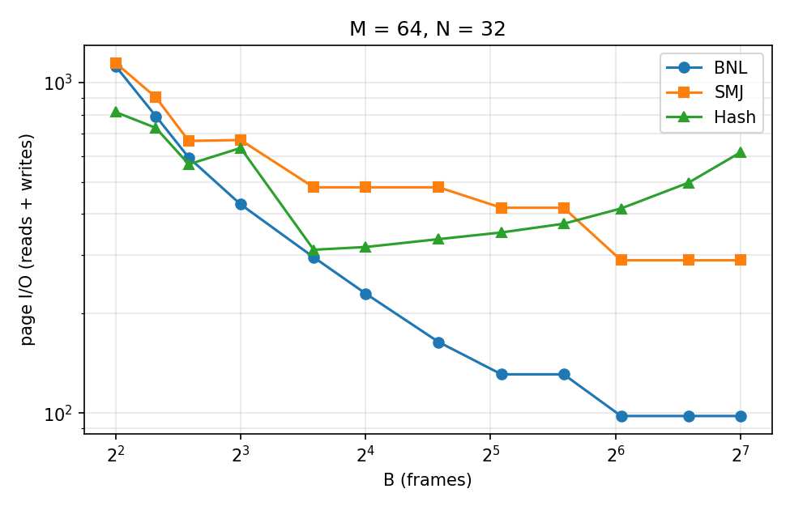
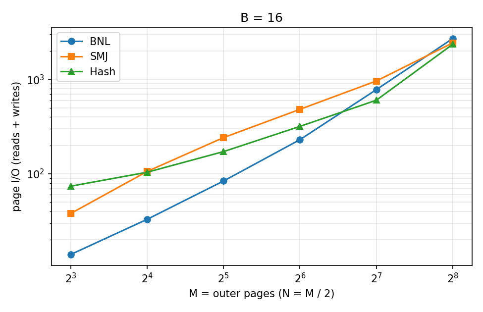

# Module 2 report: execution engine measurements

Every number below comes from `python3 measure_m2.py`. It builds the tables,
runs each plan through the same code as `exec run`, and writes
`results/m2/*.csv` and the two plots. Counters are page I/O and comparisons,
not time, so the numbers are the same on every machine and on every run
(tested: same plan, same B, same counters).

**Data.** Records are `id:INT, k:INT, pad:VARCHAR(200)`, 210 bytes, so 19 per
page. The join key `k` is uniform over 1000 values unless stated otherwise.
M is the number of data pages of the left (outer, build) input and N of the
right, with N = M / 2. **Measured reads always include the heap's directory
page** (one per scan of a table up to 681 pages). The formulas don't count
it, so a measured value is at least formula + 1 per table scan.

## 1. Cost against formula

Formulas from Section 2 with the plan's B:

- BNL: reads M + ceil(M/(B−2)) × N, no writes.
- SMJ: the sorts write each input once per pass (including the final run,
  since the merge reads it back), then the merge reads M + N.
- Hash: reads 2(M + N), writes M + N.

| Join | M | N | B | formula reads | measured reads | formula writes | measured writes | comparisons |
|---|---|---|---|---|---|---|---|---|
| BNL | 16 | 8 | 4 | 80 | 89 | 0 | 0 | 46,208 |
| SMJ | 16 | 8 | 4 | 88 | 110 | 64 | 84 | 3,635 |
| Hash | 16 | 8 | 4 | 48 | 96 | 24 | 58 | 49 |
| BNL | 16 | 8 | 16 | 32 | 33 | 0 | 0 | 46,208 |
| SMJ | 16 | 8 | 16 | 48 | 66 | 24 | 40 | 3,766 |
| Hash | 16 | 8 | 16 | 48 | 65 | 24 | 39 | 49 |
| BNL | 16 | 8 | 64 | 24 | 26 | 0 | 0 | 46,208 |
| SMJ | 16 | 8 | 64 | 48 | 50 | 24 | 24 | 3,563 |
| Hash | 16 | 8 | 64 | 48 | 144 | 24 | 122 | 49 |
| BNL | 16 | 8 | 256 | 24 | 26 | 0 | 0 | 46,208 |
| SMJ | 16 | 8 | 256 | 48 | 50 | 24 | 24 | 3,563 |
| Hash | 16 | 8 | 256 | 48 | 190 | 24 | 275 | 49 |
| BNL | 64 | 32 | 4 | 1088 | 1121 | 0 | 0 | 739,328 |
| SMJ | 64 | 32 | 4 | 448 | 622 | 352 | 524 | 18,461 |
| Hash | 64 | 32 | 4 | 192 | 489 | 96 | 325 | 5,568 |
| BNL | 64 | 32 | 16 | 224 | 230 | 0 | 0 | 739,328 |
| SMJ | 64 | 32 | 16 | 288 | 290 | 192 | 192 | 19,729 |
| Hash | 64 | 32 | 16 | 192 | 208 | 96 | 110 | 764 |
| BNL | 64 | 32 | 64 | 128 | 129 | 0 | 0 | 739,328 |
| SMJ | 64 | 32 | 64 | 192 | 258 | 96 | 160 | 19,264 |
| Hash | 64 | 32 | 64 | 192 | 255 | 96 | 157 | 764 |
| BNL | 64 | 32 | 256 | 96 | 98 | 0 | 0 | 739,328 |
| SMJ | 64 | 32 | 256 | 192 | 194 | 96 | 96 | 18,203 |
| Hash | 64 | 32 | 256 | 192 | 526 | 96 | 464 | 764 |
| BNL | 256 | 128 | 4 | 16640 | 16769 | 0 | 0 | 11,829,248 |
| SMJ | 256 | 128 | 4 | 2304 | 3246 | 1920 | 2860 | 87,749 |
| Hash | 256 | 128 | 4 | 768 | 2342 | 384 | 1188 | 447,130 |
| BNL | 256 | 128 | 16 | 2688 | 2708 | 0 | 0 | 11,829,248 |
| SMJ | 256 | 128 | 16 | 1408 | 1410 | 1024 | 1024 | 94,059 |
| Hash | 256 | 128 | 16 | 768 | 1465 | 384 | 890 | 11,831 |
| BNL | 256 | 128 | 64 | 896 | 902 | 0 | 0 | 11,829,248 |
| SMJ | 256 | 128 | 64 | 1152 | 1154 | 768 | 768 | 93,918 |
| Hash | 256 | 128 | 64 | 768 | 832 | 384 | 446 | 11,831 |
| BNL | 256 | 128 | 256 | 512 | 513 | 0 | 0 | 11,829,248 |
| SMJ | 256 | 128 | 256 | 768 | 1026 | 384 | 640 | 91,456 |
| Hash | 256 | 128 | 256 | 768 | 1024 | 384 | 639 | 11,831 |

### Where measurement and formula disagree, and why

**BNL agrees up to directory pages.** The measured reads are always
formula + 1 + ceil(M/(B−2)): one directory page for the outer scan, and one
more every time the inner is rescanned. For example, M = 256 at B = 4 gives
128 blocks, so 16,640 + 1 + 128 = 16,769. The comparison count is exactly
|R| × |S| (4864 × 2432 = 11,829,248) at every B, as §2.7 says it must be:
it depends on neither B nor the condition. No pool hits help here, because
between rescans the inner's pages are pushed out of the few unpinned
frames before they are needed again.

**SMJ is one pass worse than the formula when M or N is just above a
multiple of B.** Look at M = 64, B = 64 (258 vs 192) and M = 256, B = 256
(1026 vs 768). The formula sorts with all B frames, but our sort gets
F = B − 1: its child's seqscan holds one frame during pass 0. So 64 pages
at B = 64 make ceil(64/63) = 2 runs and need a merge pass, where the
formula sees ceil(64/64) = 1 run. At B = 4 the same thing compounds:
F = 3 gives a merge fan-in of 2 instead of 3, so 64 pages take 6 passes
instead of 4. Where a pass boundary isn't crossed (B = 16 and 64 at
M = 256), measured equals formula + 2 directory pages exactly. A small
input that fits in one page (N = 8 at B = 64 and 256) is never written,
which is why measured writes can be below N × passes.

**Hash is close to 3(M + N) only when every partition fits.** The formula
assumes each R_i fits in B − 1 pages, which needs roughly M ≤ (B − 1)².
Where it holds (M = 64 at B = 16, M = 256 at B = 64), the gap is small and
has two causes. The directory pages add 2. Every non-empty partition also
ends on a partly filled page, so partition writes are up to P pages more
than M + N. Two cases break that assumption:

- **B too small.** M = 64 at B = 4 has P = 3, so the partitions are 20 to
  24 pages against a table of 3. All three are re-partitioned, then 9 of
  their sub-partitions are re-partitioned again, and 3 pairs still end in
  the nested-loop fallback: 489 reads instead of 192. M = 256 at B = 16
  gives partitions of 17 to 22 pages against a table of 15, so 12 of the
  15 are re-partitioned once, roughly doubling the I/O.
- **B much larger than the data.** M = 16 at B = 256 writes 275 pages, more
  than 10 × (M + N). §2.9 fixes P = B − 1 = 255, so 24 pages of data are
  scattered over hundreds of partitions, each its own partly filled page.
  An implementation that chose P from M (P = ceil(M / (B − 2))), or skipped
  partitioning when R fits in memory, would avoid this. We kept the
  handout's P = B − 1 so the formula is the one being tested.

## 2. Sort passes

`sort` on `k, id`. The sort's F is B − 1 (its seqscan child holds one frame
in pass 0), and the formula is evaluated with F. Merge passes carry a last
single run forward (§10 of DESIGN_M2.md).

| N | plan B | sort F | initial runs | formula(N, F) | measured passes | sort reads | sort writes |
|---|---|---|---|---|---|---|---|
| 8 | 4 | 3 | 3 | 3 | 3 | 14 | 14 |
| 8 | 5 | 4 | 2 | 2 | 2 | 8 | 8 |
| 8 | 16 | 15 | 1 | 1 | 1 | 0 | 0 |
| 50 | 4 | 3 | 17 | 6 | 6 | 242 | 242 |
| 50 | 5 | 4 | 13 | 4 | 4 | 148 | 148 |
| 50 | 8 | 7 | 8 | 3 | 3 | 100 | 100 |
| 50 | 16 | 15 | 4 | 2 | 2 | 50 | 50 |
| 80 (= 20 × 4) | 4 | 3 | 27 | 6 | 6 | 390 | 390 |
| 80 | 8 | 7 | 12 | 3 | 3 | 160 | 160 |
| 80 | 16 | 15 | 6 | 2 | 2 | 80 | 80 |
| 200 | 4 | 3 | 67 | 8 | 8 | 1366 | 1366 |
| 200 | 5 | 4 | 50 | 5 | 5 | 800 | 800 |
| 200 | 8 | 7 | 29 | 3 | 3 | 400 | 400 |
| 200 | 16 | 15 | 14 | 2 | 2 | 200 | 200 |

Measured passes equal the formula in all 20 combinations measured (the full
list is in `results/m2/sort_passes.csv`). The first row is the 2.5 worked
example: 8 pages with F = 3 give 3 runs (3, 3 and 2 pages). Pass 1 merges
two runs and carries the third. The sort reports 14 reads and 14 writes;
its seqscan reports 9 (8 data pages + the directory page). The plan total
is 23 / 14 against the handout's 22 / 14, and the difference is that
directory page.

The sort's own reads and writes are about N per pass, because its pass 0
reads belong to the seqscan. Pass 0 writes N. Each merge pass inside
`open` reads and writes up to N (less when a run is carried rather than
rewritten). The final pass reads N and writes nothing. For 80 pages at
F = 3 that is 390 reads and 390 writes over 6 passes, instead of the
2N × passes = 960 total of a sort that also read its input and wrote its
output.

## 3. Crossover

**Fixed relations (M = 64, N = 32), varying B** (total page I/O; cheapest
in bold):

| B | BNL | SMJ | Hash | cheapest |
|---|---|---|---|---|
| 4 | 1121 | 1146 | **814** | Hash |
| 5 | 791 | 902 | **729** | Hash |
| 6 | 593 | 666 | **566** | Hash |
| 8 | **428** | 670 | 634 | BNL |
| 12 | **296** | 482 | 312 | BNL |
| 16 | **230** | 482 | 318 | BNL |
| 24 | **164** | 482 | 336 | BNL |
| 34 | **131** | 418 | 352 | BNL |
| 48 | **131** | 418 | 374 | BNL |
| 66 | **98** | 290 | 416 | BNL |
| 96 | **98** | 290 | 498 | BNL |
| 128 | **98** | 290 | 615 | BNL |

**The ranking changes between B = 6 and B = 8**, where BNL overtakes hash.
BNL's cost M + ceil(M/(B−2)) × N falls like 1/B: every extra frame in the
outer block removes a share of the inner rescans. Once B − 2 ≥ M (B = 66)
it reads each relation once (98 = 64 + 32 + 2 directory pages). Hash join
can never go below 3(M + N) = 288. Below B ≈ 8 its partitions overflow
(R_i ≈ 64/(B−1) pages against a table of B − 2) and it pays for
re-partitioning and fallbacks. Above B ≈ 12 its cost *rises*, because
P = B − 1 partitions each end on a partly filled page (§1). SMJ falls in
steps, one step each time the number of sort passes drops. It never wins
here: sorting costs about 2 × passes × (M + N), and that is above hash's 3(M + N)
whenever a sort needs more than one pass.

**Fixed B = 16, varying relation size** (N = M / 2):

| M | BNL | SMJ | Hash | cheapest |
|---|---|---|---|---|
| 8 | **14** | 38 | 74 | BNL |
| 16 | **33** | 106 | 104 | BNL |
| 32 | **84** | 242 | 172 | BNL |
| 64 | **230** | 482 | 318 | BNL |
| 128 | 779 | 962 | **602** | Hash |
| 256 | 2708 | 2434 | **2355** | Hash |

**The ranking changes between M = 64 and M = 128**, where hash overtakes
BNL. At B = 16 the outer block is 14 pages, so BNL rescans the inner
ceil(M/14) times: its cost grows like M × N / 14, quadratically. Hash join
grows linearly (3(M + N)) as long as its partitions fit, which at B = 16
lasts until M ≈ 15 × 14 = 210 pages. At M = 256 the partitions overflow
(about 17 pages each against 15), so hash pays one re-partition and its
lead over SMJ almost disappears. With still more data at this B, SMJ
(whose cost grows like M log M) could overtake hash.

## 4. Skew

Hash join at B = 16 (P = 15), M = 64, N = 32. The skewed tables put key 0
on 40% of the rows of both sides; the other rows are uniform over 1000 keys.

| Data | rows out | reads | writes | comparisons |
|---|---|---|---|---|
| uniform | 764 | 208 | 110 | 764 |
| 40% one key | 121,026 | 371 | 216 | 121,026 |

**Partition sizes (R pages, S pages).** Uniform: every level-1 partition
is 3 to 6 R pages and 2 to 3 S pages, all fit in the 15-page table, and
nothing overflows. Skewed: 14 partitions of 2 to 4 pages and one of
**(29, 15)**, the partition key 0 hashes to.

**What overflow handling did.** The 29-page R partition doesn't fit in 15
pages, so it was re-partitioned with the next seed. That split off the
other keys sharing it, leaving (27, 13). The (27, 13) pair was partitioned
again; it landed whole in one sub-partition and did not shrink, so it went
straight to the fallback. That is a block nested loop on that one pair,
14 pages of R per block (2 blocks), with S_i streamed past each block.

**Cost against the uniform case.** 587 page I/Os instead of 318 (1.8×).
The two extra partitioning rounds of the hot partition each read and write
it again, and the fallback reads S_i once per block. The output is 158
times larger: 0.4 × 1216 × 0.4 × 608 ≈ 118,000 pairs of key 0 alone. So
almost all of the comparisons are real matches, because inside the
fallback every pair has the same key. No re-partitioning can help a single
key, which is why a pair that does not shrink goes to the fallback instead
of using up the remaining depth. The result is identical to the
nested-loop and sort-merge joins on the same data (tested).

## 5. The budget

A sort of N = 80 pages (20 × B) at B = 4: 1,520 rows sorted correctly,
27 initial runs, 6 passes. **The largest number of frames held at once was
4.** We know this two ways:

1. **The pool cannot exceed B.** The plan's buffer pool has exactly 4
   frames, and every page an operator holds is pinned in it. A fifth pin
   would raise "no unpinned frame available".
2. **We recorded it.** `BufferPool.peak_pinned` counts the most frames
   pinned at once (4), and the budget's `peak_reserved` counts the most
   frames operators had reserved (4). `exec trace` prints the peak after
   every plan.

The hash table and the equal-key run of sort-merge join are not pinned
pages. They are charged by size against frames their operator reserved, so
they are covered by the second count (DESIGN_M2.md §3).

Every sample plan in `plans/` (one per operator, plus a 7-operator
pipeline) runs at B = 4 on both a 3000-row database and an empty one, and
ends with no pinned frame and no temporary file (`tests/test_m2_checklist.py`).
